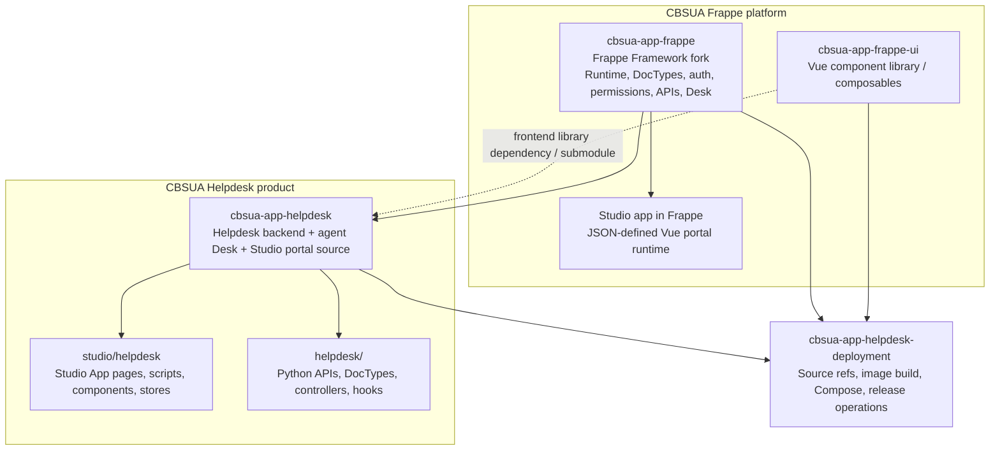

# Current Architecture and Repository Boundaries

> Status: repository inspection notes for the `feat/anonymous-tickets` workstream. Verified against the repository files listed below; re-check paths and refs when the branch changes.

## 1. Repository responsibilities

CBSUA Helpdesk is a multi-repository Frappe application stack. Do not treat `cbsua-app-helpdesk` as a self-contained application or assume that its frontend and framework are vendored entirely inside it.



### `cbsua-app-frappe` — framework dependency

This is the CBSUA-maintained Frappe Framework fork. It supplies the platform capabilities used by Helpdesk, including:

- Bench/site application runtime and migration lifecycle.
- DocTypes, ORM/database model, document controllers and hooks.
- Authentication, sessions, roles, permissions and whitelisted APIs.
- Background jobs, scheduler, realtime and core Desk.
- The Frappe Studio application/runtime used to render exported Studio Apps.

Helpdesk-specific requester behavior belongs in Helpdesk or a dedicated extension, not in the framework fork unless a reusable framework-level change is demonstrably required.

### `cbsua-app-frappe-ui` — frontend UI library dependency

This is the CBSUA-maintained fork of Frappe UI, the Vue-based frontend component library. It supplies shared UI components, composables, utilities and styling consumed by the Helpdesk frontend.

It is not the Studio runtime and is not a separately installed Frappe app. It is consumed as a frontend source dependency/submodule in the Helpdesk repository/build.

**Submodule provenance check:** the `.gitmodules` file inspected on the current `develop` branch declared path `frappe-ui` with URL `https://github.com/frappe/frappe-ui.git`, while the CBSUA fork repository exists separately. Before depending on CBSUA-only UI changes, verify the `.gitmodules` URL and gitlink SHA on `feat/anonymous-tickets`, and verify the deployment source lock/build checkout. Do not infer that the CBSUA fork is actually built merely because it exists. Resolve the URL/ref mismatch deliberately if needed; preserve the exact tested gitlink SHA.

### `cbsua-app-helpdesk` — application and portal source

This repository contains the Helpdesk app: backend Python code, DocTypes/controllers, API methods, hooks, agent Desk frontend and the exported Studio customer portal.

It depends on the CBSUA framework fork for its runtime and on the Frappe UI library for frontend components. It is not the deployment repository.

### `cbsua-app-helpdesk-deployment` — release and runtime assembly

This repository owns deployment-specific source refs/source lock, image assembly, Compose configuration, release promotion, operational runbooks, backups and rollback. The exact framework, Helpdesk, Telephony and UI source revisions used in a build must be verified there rather than inferred from branch names.

## 2. Customer portal: Studio, not a standalone Vue router app

The customer-facing portal at `/help` is an exported **Studio App named `helpdesk`**, defined in this repository under `studio/helpdesk/`. Studio ships with the Frappe framework fork.

The Studio app record in `studio/helpdesk/helpdesk.json` identifies:

- `app_name`: `helpdesk`
- `route`: `help`
- `app_home`: the public knowledge-base page

Studio renders each page from a JSON block tree. A page can also have a TypeScript setup script. Custom Vue components are referenced from those block trees and rendered by Studio. Do not add a separate Vue router or replace the Studio app architecture for this feature.

### Studio source layout

The portal README (`studio/README.md`) documents this layout:

```text
studio/helpdesk/
  helpdesk.json
  router.ts
  studio_page/<page>/
    <page>.json
    <page>.ts
  studio_components/
  components/
  stores/
  composables/
  shared/
```

- `.json` files define Studio App/Page/Component records and page block trees.
- Page `.ts` files export `setup(context)`; their returned values are exposed to blocks.
- `components/` contains custom Vue components referenced by Studio block definitions.
- `stores/` and `composables/` hold portal state and page logic.
- Shared code is used by both the portal and agent Desk only when genuinely shared; preserve existing imports and conventions.

Studio source files are the source of truth for standard app pages. `bench migrate` imports the standard records into Studio DocTypes; developer-mode editor saves write source files. Build the Studio bundle with the documented Frappe commands, not by treating the JSON as a conventional Vue route component.

### Existing portal pages and access

The current `studio/README.md` documents these page routes:

| Studio page | Portal URL | Guest access | Purpose |
|---|---|---:|---|
| `public_kb` | `/help` | Yes | Public knowledge-base home |
| `categories` | `/help/categories` | Yes | Knowledge-base categories |
| `category` | `/help/category/:category` | Yes | Category articles |
| `article` | `/help/articles/:name` | Yes | Public article |
| `customer_tickets` | `/help/my-tickets` | No | Authenticated ticket list |
| `new_ticket` | `/help/tickets/new` (legacy redirect may route to `/help/my-tickets/new`) | No | Authenticated ticket creation |
| `ticket` | `/help/tickets/:name` | No | Authenticated ticket conversation |

The exact route aliases and current route constants must be checked in the actual shared portal route source before adding a new route.

### Guest/session behavior

The current portal session store (`studio/helpdesk/stores/session.ts`) derives `isGuest` from the config response and defines `canCreateTicket` as false for guests. It also redirects guests to login when the knowledge base is private.

The existing new-ticket Studio Page JSON (`studio/helpdesk/studio_page/new_ticket/new_ticket.json`) has `allow_guest: 0`. Therefore, exposing anonymous ticket creation is not just a backend API change: it needs a Studio page explicitly available to guests and deliberate session/navigation/UI behavior that preserves the existing authenticated routes.

A dedicated `/help/guest/new` Studio page is a viable proposed route, but must be added using the Studio page source conventions, route constants and guest-access metadata. Do not simply flip the existing authenticated new-ticket page to guest access.

## 3. Existing ticket creation and requester model

The existing portal form is the custom Vue component `NewTicketForm.vue`, used by the Studio `new_ticket` page. It currently:

1. Loads the existing ticket template and field layout.
2. Loads CBSUA offices and office-specific request types.
3. Validates subject, description and configured required fields in the browser.
4. Uploads private attachments through the existing authenticated upload path.
5. Calls `helpdesk.helpdesk.doctype.hd_ticket.api.new`.

The backend `api.new` function currently:

- Is whitelisted without `allow_guest=True`.
- Accepts the ticket document, attachments and optional portal origin.
- Sets `doctype = "HD Ticket"`.
- Sets `via_customer_portal` from the current session user.
- Sets `raised_by = frappe.session.user`.
- Inserts the native `HD Ticket` and returns fields filtered through `TicketFields`.

The `HD Ticket` DocType currently has a `raised_by` Data field with Email options and permission level 7. This is already a requester-email-shaped field, but the authenticated API populates it with the session user. Its use in notification routing, permissions, inbound email association and other lifecycle code must be traced before deciding whether it is sufficient for verified anonymous requesters.

**Implication:** do not expose the existing `api.new` method to guests or merely allow guests on the current Studio page. Its current assumptions are authenticated-session assumptions. Implement a narrowly scoped guest submission service that sets requester identity and privileged ticket fields server-side, then creates a native ticket through the normal controller lifecycle.

### Existing permission and hook boundaries

The app registers:

- `permission_query_conditions["HD Ticket"]` and `has_permission["HD Ticket"]` to enforce ticket access.
- `doc_events["HD Ticket"]` hooks for CBSUA office routing defaults and validation.
- Studio boot and website-context hooks for the portal shell.
- Redirects from legacy `/helpdesk` customer portal paths to `/help`.

These hooks and native permission checks must remain intact. Do not bypass them with `ignore_permissions=True` for normal ticket creation or introduce broad Guest DocType Create/Read permissions.

## 4. Anonymous ticket implementation implications

1. Add a separate guest-accessible Studio page under the existing Studio app; do not replace the authenticated `new_ticket` page.
2. Reuse existing portal design patterns and Frappe UI components. Prefer a guest-specific component or an explicitly designed guest mode over changing authenticated form assumptions implicitly.
3. Build a guest-only server API with strict allowlisted input fields, explicit POST method, type validation, rate limiting, safe error responses and idempotent verification handling.
4. Do not expose the normal `HD Ticket` DocType directly to Guest permissions.
5. Keep email verification as a proposed abuse/identity safeguard. If adopted, verification must precede ticket creation and be bound to the submission. Never treat an unverified email string as proof of requester ownership.
6. Inspect upload handling separately. The existing form uploads private files through an authenticated flow; do not enable guest uploads by changing a generic upload permission. The MVP may exclude attachments until a safe guest upload-and-attach lifecycle is designed.
7. Keep anonymous ticket updates in the existing Helpdesk notification lifecycle, but verify that only requester-visible content is emailed. Do not expose internal comments, private attachments, agent-only fields or ticket details through a public endpoint.
8. Do not add a public ticket list/detail route. Anonymous requesters receive updates through email.
9. Future account association must be an explicit, auditable identity-linking process for verified email addresses, not automatic matching on an arbitrary string.

## 5. Development and verification workflow

### Framework / Studio

Consult the Studio-specific instructions in the actual framework checkout:

- `studio/frontend/README.md` for Studio frontend dev server and `watch-studio`.
- `studio/skills/studio-app-building/SKILL.md` for exported Studio App structure and sync behavior.
- `RULES.md`, `ROUTING.md`, and `DESIGN.md` in that skill folder for runtime bindings, routes/global boot, and visual conventions.

The Helpdesk portal README documents using `/dev/help` during development, running the Studio watcher, and building the production bundle after development. Follow the exact instructions for the checked-out framework version.

### Frappe app development

The official `frappe-app-dev` skill requires using Pilot for Frappe development, explicitly targeting the site for commands, testing in the correct compatible framework bench, and scanning changed files with Frappe Semgrep rules. Follow the installed version of the skill and the repository's local testing instructions.

The official `frappe-code-review` skill emphasizes correctness/atomicity, strict guest trust boundaries, typed inputs, permission checks, race conditions, least privilege, supported extension points and backward compatibility.

The LUBUS `api-development`, `frontend-development`, `web-forms`, `doctype-development`, and `testing` skills are useful supplementary references. They do not override the actual Studio architecture or repository-specific conventions. In particular, a generic Frappe Web Form is not the default recommendation for this feature because the customer portal is already implemented as a Studio App.

## 6. Repository facts to re-verify at implementation time

- [ ] Framework branch/commit and exact Studio version used by Helpdesk.
- [ ] `frappe-ui` submodule URL and gitlink SHA on this feature branch; verify whether it points to the CBSUA fork.
- [ ] Deployment source-lock SHA for framework, Helpdesk, UI submodule and required apps.
- [ ] Exact `ROUTES` source file path and route helper conventions.
- [ ] Existing requester-email use across ticket controller, notification templates, inbound email, contact/customer association and ticket permissions.
- [ ] Exact guest-safe office/request-type API behavior and whether those APIs are intentionally public.
- [ ] Upload API permissions and private file lifecycle.
- [ ] Current tests covering portal ticket creation, customer visibility, notifications and email replies.


## 7. Detailed ticket lifecycle findings from the Phase 0 trace

The following behavior was verified in the current feature branch's tracked source. It narrows the design but does not yet complete the audit of outbound/inbound email processing.

### Ticket creation API

Source: `helpdesk/helpdesk/doctype/hd_ticket/api.py`, function `new`.

- Decorated with `@frappe.whitelist()` and no `allow_guest=True`.
- Existing rate limit is 300 requests per 60 seconds, user-based. This is an authenticated-user-oriented limit and is not an appropriate anonymous abuse control.
- It accepts a document dictionary, attachment File references, and optional portal origin.
- It sets `doctype = "HD Ticket"`, `via_customer_portal` from the session, and `raised_by` from `frappe.session.user`.
- It inserts the native document and strips hidden fields for the response.

**Design consequence:** leave this method authenticated. Add a separate guest-only submission entry point rather than widening the existing method's trust boundary. The guest entry point should not accept arbitrary DocType fields or arbitrary File names.

### HD Ticket controller lifecycle

Source: `helpdesk/helpdesk/doctype/hd_ticket/hd_ticket.py`.

- `before_validate` calls `set_raised_by`, `validate_portal_contact`, `set_contact`, `set_customer`, and ticket-origin handling.
- `set_raised_by` falls back to `frappe.session.user` only when the field is empty.
- `set_contact` attempts to find a Contact whose `email_id` matches the email parsed from `raised_by`.
- `validate_portal_contact` restricts non-agent users from attributing a ticket to another Contact. A guest flow must not accept a client-selected Contact or impersonate an existing Contact owner.
- `set_customer` may derive an HD Customer from the matched Contact when the setting `auto_set_customer_from_contact` is enabled.
- `after_insert` creates a Communication from the description and sends the acknowledgement email only when `via_customer_portal` is false (and acknowledgement is enabled). The existing portal form therefore does not rely on that acknowledgement path.
- The controller generates a UUID `key`; inspect every use before treating it as a guest access credential. It is currently also used by email feedback flow.

**Design consequence:** a verified external email can potentially be represented by the existing `raised_by` field, but Contact/customer auto-association must be explicitly constrained. Do not attach an anonymous ticket to a Contact merely because the submitted email string matches a record linked to a different user. Preserve the native lifecycle and add only the smallest safe integration needed.

### CBSUA office routing

Source: `helpdesk/setup/office_routing.py`, registered from `helpdesk/hooks.py` as HD Ticket `before_validate` and `validate` events.

- `set_ticket_defaults` supplies a default office.
- It supplies a default request type for tickets where `via_customer_portal` is false.
- `validate_ticket_office_routing` requires a valid enabled office and request type for new tickets.
- The request type can supply the default team, with team-to-office consistency checked.
- Non-privileged users cannot select a team not mapped to the selected office.

**Design consequence:** guest tickets need the same required office/request-type values and validation as customer-portal tickets. The guest service must set the server-controlled portal-origin flag deliberately and must not trust a submitted team or agent. Confirm how this flag interacts with all existing controller behavior before choosing its exact value.

### Existing frontend form

Source: `studio/helpdesk/studio_page/new_ticket/new_ticket.json`, its TypeScript setup, and `studio/helpdesk/components/ticket/NewTicketForm.vue`.

- The page is not guest-enabled.
- The form loads the ticket template and dynamic fields.
- The CBSUA form additionally loads offices and request types.
- It uses authenticated file upload and then passes File names to the ticket creation API.
- It calls the existing authenticated API directly.

**Design consequence:** reuse the visual/form conventions and office/request-type interaction, but do not assume the current upload flow works for guests. For the first MVP, excluding attachments is safer than weakening generic upload permissions. If attachments are required in the first release, design a guest-scoped upload lifecycle with ownership, expiry, size/type restrictions, and safe association after verification.

### Email communication status

The controller's agent reply method defaults its recipient to `raised_by`, creates a linked Communication, and can send a threaded email through the configured outgoing account. Its email body/template path is aware of `via_customer_portal`.

The initial trace has **not yet established** all of the following:

- whether inbound email replies are enabled and how they identify the ticket;
- how sender addresses are validated against the ticket requester;
- which inbound messages become public Communications versus internal comments;
- which status-change notifications are sent to external requester addresses;
- whether every outbound template is safe for an anonymous external requester.

These are open Phase 0 items. Do not claim inbound email replies are supported for anonymous tickets until they are verified end-to-end.

